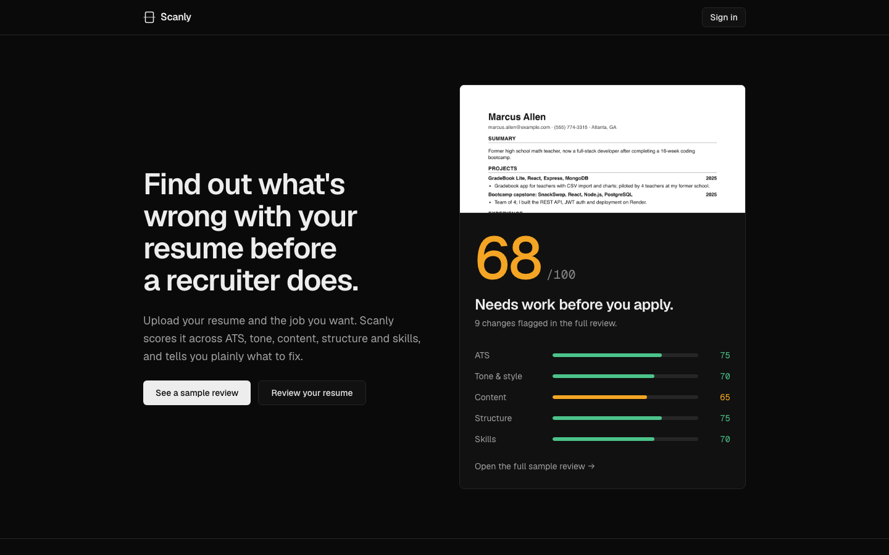
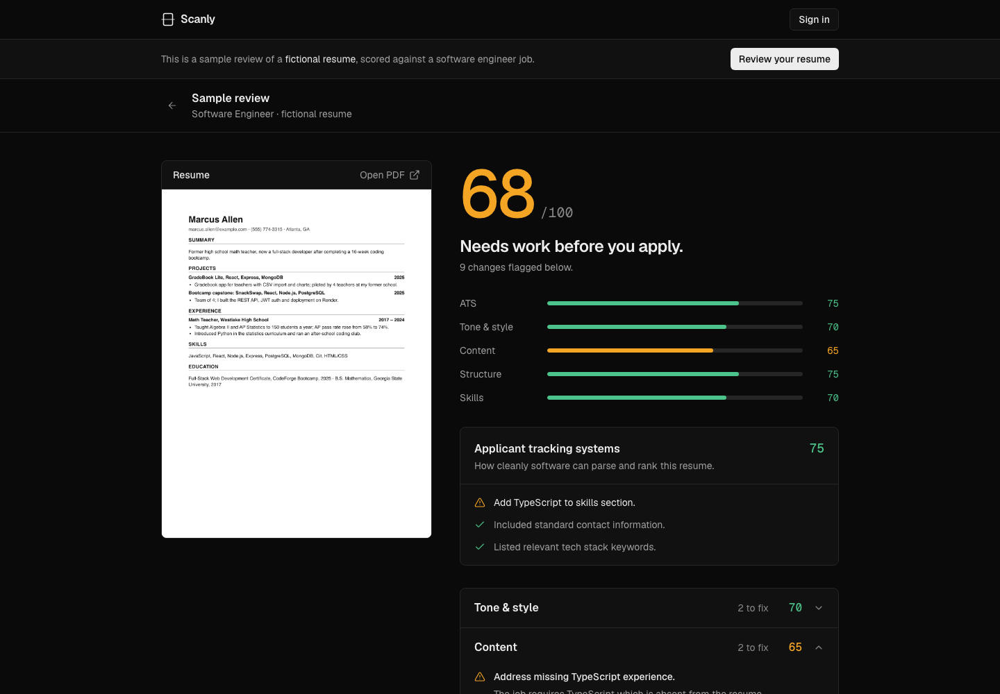
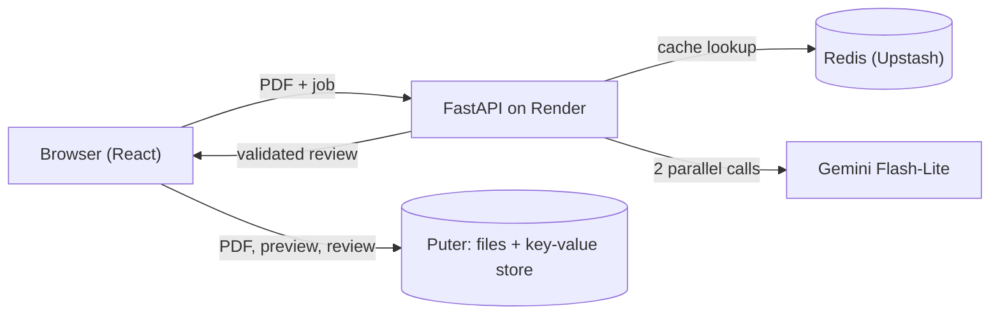

# Scanly

Scanly reviews your resume the way a strict recruiter would. Upload a PDF and the job you're applying for, and you get a score out of 100, five category scores, and the specific changes to make first.

**[Live site](https://scanlycv.vercel.app)** · **[Sample review](https://scanlycv.vercel.app/demo)** (no sign-in needed)



## Features

- **Scored against the job.** Paste a job title and description and the review is tailored to that posting, or leave them blank for a general review.
- **A blunt verdict.** An overall score with a one-line verdict ("Needs work before you apply."), plus scores for ATS, tone and style, content, structure, and skills.
- **Fixes before praise.** Each category lists what to fix before what's working, and the weakest category opens first.
- **Resume beside the feedback.** The review page shows the resume next to its scores so every point can be checked.
- **Live analysis log.** Uploading shows each step with timings, and a clear error and retry if something fails.
- **History you control.** Reviews are saved to your account, and you can reopen or delete any of them.
- **Public sample review** at `/demo`, so visitors can see a full review before signing in.



## Performance

I profiled and optimized the analysis backend, measuring each change with a side-by-side benchmark (`scripts/benchmark.py`) that alternates requests between the old and new versions so changes in Gemini's load affect both equally.

Final result, original vs optimized, 22 runs each on Gemini Flash-Lite:

| | Original | Optimized | Change |
|---|---|---|---|
| Median | 3.7 s | **1.9 s** | −49% |
| p90 | 5.1 s | **2.4 s** | −53% |
| Slowest run | 11.0 s | **2.7 s** | −75% |
| Repeat analysis (cache hit) | n/a | **~12 ms** | no LLM call |

The optimized version was faster in 22 of 22 paired runs. Profiling with per-step `Server-Timing` instrumentation showed more than 99.9% of each request was the LLM call, so every change targeted it:

1. **Send text instead of the PDF.** PyMuPDF extracts the text in 2 to 4 ms. Scanned, image-only PDFs fall back to sending the file. (~9% faster)
2. **Ask for less output.** A tighter prompt cut output tokens from 1,012 to 490. LLMs generate output one token at a time, so this saved about three times more than trimming the input. (~25% faster)
3. **Score sections in parallel.** Two Gemini calls run at once with `asyncio.gather`. The first call also returns the overall score, so it stays a holistic judgement rather than an average. (~26% faster)
4. **Cache repeats in Redis**, keyed on a SHA-256 hash of the resume text and job. The same input always gets the same review, with no LLM call.

## How it works



1. The browser renders the resume's first page to a PNG with pdf.js for the preview.
2. It sends the PDF and job details to `POST /api/analyze`.
3. The backend extracts the text, checks the cache, and on a miss sends two parallel Gemini calls with a JSON schema. Each response is validated with Pydantic before it's returned.
4. The browser saves the PDF, preview, and review in the user's own Puter account.

**Where data lives.** There's no database to run. Reviews are stored in Puter's key-value store and files in Puter storage, both in each user's own account. Redis is only a cache; clearing it loses nothing. The Gemini API key stays on the backend and never reaches the browser.

**Reliability.** Flash-Lite is the primary model, with Flash as a fallback. Overload errors (500/503) get one retry after a second, and quota errors (429) fall back immediately. If any parallel call fails, the request returns a clear error instead of a review with missing sections. Billing and API-key problems show users a plain message, and the real cause goes to the server log.

## Tech stack

| Part | Built with |
|---|---|
| Frontend | React 19, React Router 7 (SPA mode), TypeScript, Tailwind CSS 4, pdf.js |
| Backend | Python, FastAPI, Pydantic, asyncio, PyMuPDF, Google Gen AI SDK |
| AI | Gemini Flash-Lite (`gemini-flash-lite-latest`), Flash as fallback |
| Cache | Redis (Upstash in production) |
| Accounts and storage | [Puter](https://puter.com) (puter.js) |
| Hosting | Vercel (frontend), Render (backend) |
| Testing | pytest with a mocked Gemini client (40 tests) |

## Getting started

### Prerequisites

- Node.js 20+
- Python 3.11+
- A free Gemini API key from [Google AI Studio](https://aistudio.google.com/apikey)
- A Puter account (you can create one the first time you sign in)

### 1. Install

```bash
git clone git@github.com:christianh-9/scanly.git
cd scanly
npm install
```

### 2. Start the backend

```bash
cd server
python3 -m venv .venv
.venv/bin/pip install -r requirements-dev.txt
cp .env.example .env    # then add your key: GEMINI_API_KEY=...
.venv/bin/uvicorn main:app --reload --port 8001
```

API docs are at http://localhost:8001/docs. Keep your key in `server/.env`, which is git-ignored, and never in `.env.example`.

### 3. Start the frontend

In a second terminal, from the project root:

```bash
npm run dev
```

Open http://localhost:5173. The dev server forwards `/api` requests to the backend on port 8001.

### Environment variables

| Variable | Where | Required | Purpose |
|---|---|---|---|
| `GEMINI_API_KEY` | backend | yes | Gemini API key |
| `ALLOWED_ORIGINS` | backend | in production | Frontend URLs allowed to call the API, comma-separated |
| `REDIS_URL` | backend | no | Enables the cache, e.g. `rediss://default:<password>@<host>:6379`. Without it the app runs uncached. |
| `GEMINI_MODELS` | backend | no | Model order, comma-separated. Default `gemini-flash-lite-latest,gemini-flash-latest` |
| `RESUME_INPUT` | backend | no | `pdf` sends the PDF instead of extracted text (used for benchmarking and as a rollback) |
| `VITE_API_URL` | frontend | in production | Backend URL. Empty in local dev. |

## Tests and benchmarks

```bash
cd server && .venv/bin/pytest     # 40 tests, Gemini is mocked so no API quota is used
npm run typecheck                 # frontend type check, from the project root
```

To benchmark, generate the fictional sample resumes once, then run the benchmark against a running backend:

```bash
server/.venv/bin/python scripts/make_sample_resumes.py
server/.venv/bin/python scripts/benchmark.py --url http://localhost:8001
# compare two backends side by side:
server/.venv/bin/python scripts/benchmark.py --url http://localhost:8002 --compare http://localhost:8003
```

The benchmark reports the median and p90, output tokens, cache hits and misses, and any fallbacks or failures. Use `--interval` to stay under your Gemini rate limit.

## Deployment

Both services redeploy automatically on `git push`.

**Backend on [Render](https://render.com)** (free web service):

| Setting | Value |
|---|---|
| Root directory | `server` |
| Build command | `pip install -r requirements.txt` |
| Start command | `uvicorn main:app --host 0.0.0.0 --port $PORT` |
| Health check path | `/api/health` |
| Environment | `GEMINI_API_KEY`, `ALLOWED_ORIGINS`, `PYTHON_VERSION=3.12.12`, optionally `REDIS_URL` |

Free Render services sleep after 15 idle minutes. The landing, demo, and upload pages ping `/api/health` when they open, and an uptime monitor (such as UptimeRobot) calling `/api/health` every 5 minutes keeps the server awake. The health check accepts both GET and HEAD.

**Frontend on [Vercel](https://vercel.com):** import the repo and set `VITE_API_URL` to the Render URL. Vite builds it into the site, so redeploy after changing it.

**Cache on [Upstash](https://upstash.com)** (optional): create a Redis database in the same region as the Render service and set its `rediss://` URL as `REDIS_URL` on Render.

## Troubleshooting

- **"Gemini is overloaded right now"**: Gemini is busy. Wait a minute and try again.
- **"Analysis is temporarily unavailable"**: a problem on the server side, such as an invalid API key or depleted billing credit. The Render logs show the real cause as `gemini error code=...`.
- **The first analysis takes 20+ seconds**: the Render server was asleep. Later requests are fast; an uptime monitor prevents this.
- **"Analysis failed… Is the backend running?"**: start the backend (step 2), or check `VITE_API_URL` in production.
- **`KeyError: 'GEMINI_API_KEY'` on startup**: `server/.env` is missing or empty.

## Privacy

Resumes are sent to Google Gemini for analysis. Files and reviews are stored in the user's own Puter account, and deleting a review removes its PDF and preview image too. The sample review uses a fictional resume.

## License

No license has been specified. All rights reserved by christianh-9.

## Acknowledgments

- [pdf.js](https://mozilla.github.io/pdf.js/) and [PyMuPDF](https://pymupdf.readthedocs.io/) for PDF handling
- [Puter](https://puter.com) for accounts and storage
- [Google Gemini](https://ai.google.dev/) for analysis
- Icons adapted from [Lucide](https://lucide.dev) (ISC)
